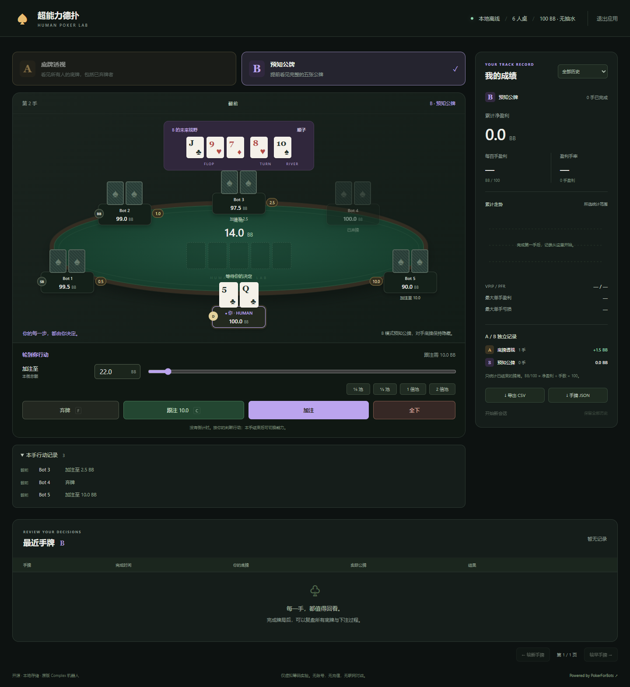

# Poker Superpower Simulator

A local, open-source six-player No-Limit Hold'em experiment: **one human and five original PokerForBots complex bots**. The human makes every decision. There is no automated A/B strategy or betting recommendation.

[中文说明](README.md) · [MIT license](LICENSE)



- **A — hole-card vision:** see all opponent hole cards, even after they fold. Future board cards remain unknown.
- **B — future-board vision:** see the five precommitted board cards in order. Opponent cards remain hidden until the hand ends.
- 100 BB per player per hand, 0.5 / 1 BB blinds, no rake, no ante, no burns, stacks reset each hand. The button rotates independently within each ability mode.
- Bots never receive the human's private information and are never forced to call.
- A and B maintain separate completed-hand statistics: net BB, BB/100, profitable-hand percentage, VPIP/PFR, cumulative curves, history and exports.
- Refreshing or restarting resumes the unfinished hand. Ability switching and new sessions require the current hand to finish.
- Offline operation, virtual chips, no account, no telemetry, no payments and no network multiplayer.

## Run a release

Download a matching ZIP from [GitHub Releases](https://github.com/wykhao/Poker_Superpower_Simulator/releases/latest). Windows users can [download the x64 build](https://github.com/wykhao/Poker_Superpower_Simulator/releases/download/v0.1.0/poker-human-simulator-0.1.0-windows-amd64.zip), unzip it and double-click `poker-simulator.exe`. macOS/Linux users run:

```sh
chmod +x poker-simulator
./poker-simulator
```

The browser opens automatically. The server binds only to `127.0.0.1:8787`. Use `--port 0` for a free port, `--no-browser` to suppress automatic opening, or `--data-dir ./my-history` for a separate profile. Quit through the page's top-right button. Builds are currently unsigned and not notarized.

Default data lives in the OS user configuration directory under `poker-human-simulator/history.json`. Data is local and is not included in release archives. Back up that directory to preserve both completed hands and a pending hand. Only one process can use a data directory at a time.

## Build from source

Go 1.25.1+ is required. Dependencies are vendored and the UI is embedded, so neither Node nor the original experiment folder is required.

```sh
go run ./cmd/poker-simulator
go test ./...
go vet ./...
go build -trimpath -buildvcs=false -o bin/poker-simulator ./cmd/poker-simulator
```

On Windows, `scripts/build.ps1` builds `bin/poker-simulator.exe`; `Start-Poker.vbs` launches it without a console. The optional Playwright smoke test is in `tests/browser.cjs` and uses isolated temporary data. See the Chinese README for browser setup.

`python scripts/release.py --version 0.1.0` creates Windows, macOS and Linux archives for x64/ARM64 plus a source ZIP, SHA256 checksums and a build manifest. Tagged `v*` pushes create a draft GitHub release for maintainer review.

## Important definitions

Raise amounts are **raise-to street totals**, not additional chips. Pot buttons first match the call, then add their fraction of the pot after calling. One displayed BB is ten internal integer chips.

`BB/100 = net BB / completed hands * 100`. An unfinished hand never enters the statistics. A new session starts a new filter group without erasing history. History pages contain 30 hands; CSV exports the selected ability/filter and JSON exports all completed hands.

Live API responses enforce the A/B information boundary; hiding a card in CSS is not the protection mechanism. The local owner can nevertheless inspect source and storage, so this is a personal experiment, not a tamper-proof leaderboard.

The bots are fixed heuristics, not a validated model of human or GTO play. See [third-party notices](THIRD_PARTY_NOTICES.md) for the pinned upstream and retained engine corrections.
